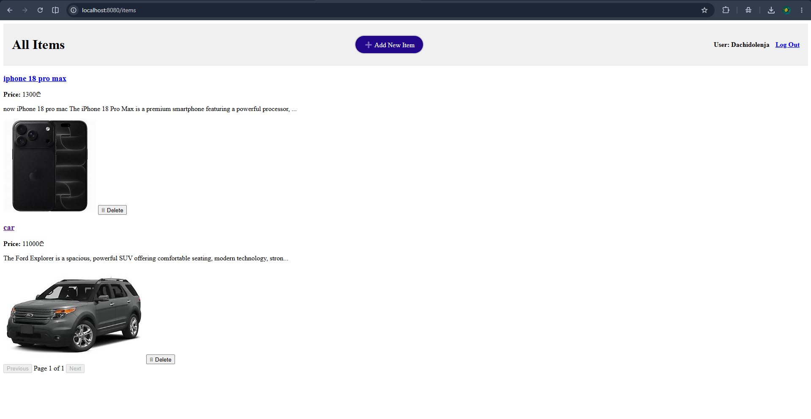
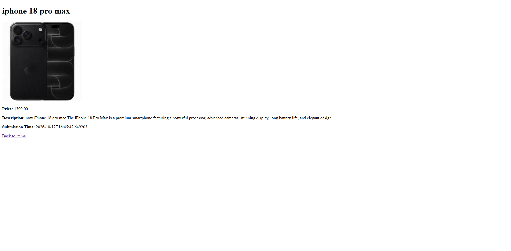
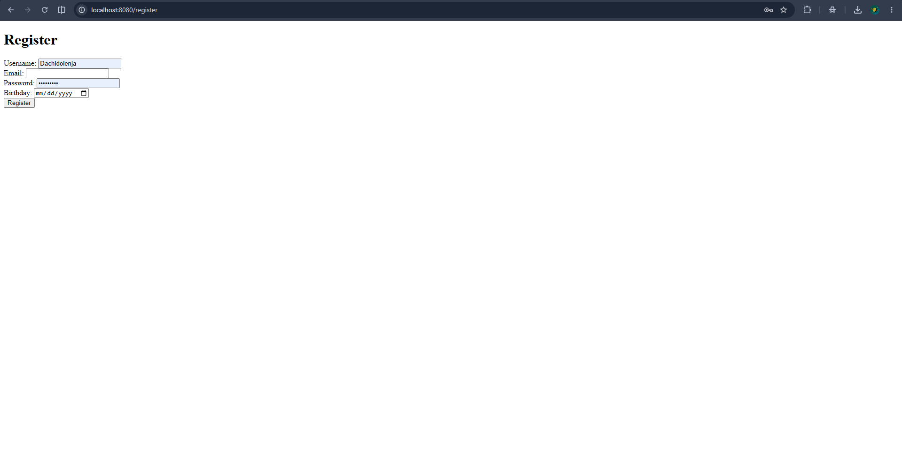

# eMarketplace

A classifieds-style web marketplace where users can register, log in, and post, browse, and delete items for sale. Built with Java, Spring Boot, and PostgreSQL.

**Live demo:** _add your deployed link here_

<!-- Add this back after you put the screenshot in docs/screenshots/:

-->

## Features

- User registration with validation (username 8-20 letters/digits, valid email, minimum age 14)
- Secure login with BCrypt-hashed passwords and session-based authentication
- Post items with name, price, description, and photo URL (input validated on the server)
- Item listing with Previous/Next pagination, and sorting through the API (newest, oldest, price low-to-high, price high-to-low)
- Item detail page
- Ownership rules: only the user who posted an item can delete it
- Database schema versioned with Flyway migrations

> The user interface is in English.

## Tech Stack

| Area | Technology |
| --- | --- |
| Language | Java 17 |
| Framework | Spring Boot 3.5 (Web, Data JPA, Validation, Thymeleaf) |
| Database | PostgreSQL |
| Migrations | Flyway |
| Security | BCrypt password hashing (Spring Security Crypto) |
| Frontend | Thymeleaf, HTML, CSS, vanilla JavaScript |
| Build | Maven (wrapper included) |
| Testing | JUnit 5 (Spring Boot Test) |

<!-- Add this back after you put the screenshots in docs/screenshots/:
## Screenshots

| Items list | Item detail | Register |
| --- | --- | --- |
|  |  |  |
-->

## Getting Started

### Run locally

Requirements: JDK 17 and a running PostgreSQL instance.

1. Create a database:
   ```sql
   CREATE DATABASE emarketplace;
   ```
2. Set the database password as an environment variable.
   - macOS / Linux: `export DB_PASSWORD=your_password`
   - Windows PowerShell: `$env:DB_PASSWORD="your_password"`
3. Start the app (Flyway creates the tables on first run):
   ```bash
   ./mvnw spring-boot:run
   ```
4. Open http://localhost:8080/register to create an account, then http://localhost:8080/items.

## Configuration

| Variable | Description | Default |
| --- | --- | --- |
| `DB_PASSWORD` | PostgreSQL password | none (required) |
| `SPRING_DATASOURCE_URL` | JDBC URL | `jdbc:postgresql://localhost:5432/emarketplace` |
| `SPRING_DATASOURCE_USERNAME` | Database user | `postgres` |
| `SERVER_PORT` | HTTP port | `8080` |

## API Overview

| Method | Path | Description | Auth |
| --- | --- | --- | --- |
| GET | `/market?page=0&size=10&sort=dateDesc` | List items (`dateDesc`, `dateAsc`, `priceAsc`, `priceDesc`) | No |
| POST | `/market` | Create an item (JSON body) | Yes |
| DELETE | `/market/{id}` | Delete your own item | Yes |
| GET | `/api/user` | Current logged-in user | Yes |
| POST | `/logout` | Log out and end the session | Yes |

Pages: `/register`, `/login`, `/items`, `/item/{id}`, `/new-item.html`

## Running Tests

```bash
./mvnw test
```

The project currently has a Spring Boot context-load test, which needs a running PostgreSQL instance and the `DB_PASSWORD` variable set.

## Project Structure

```
src/main/java/com/example/emmarketplace
├── controller   # REST and page controllers
├── service      # Business logic (users, items)
├── repository   # Spring Data JPA repositories
├── entity       # JPA entities (User, MarketItem)
└── dto          # Request objects with validation
src/main/resources
├── db/migration # Flyway SQL migrations
├── templates    # Thymeleaf pages
└── static       # CSS and static pages
```

## Roadmap

- Add service-layer unit tests with JUnit 5 and Mockito
- Replace session handling with Spring Security
- Image upload instead of photo URLs
- Search and filtering by price range
- Sorting controls in the UI
- Docker Compose setup to run the app and database with one command
- CI pipeline with GitHub Actions

## Author

Dachi - [GitHub](https://github.com/DachiDolenj)
